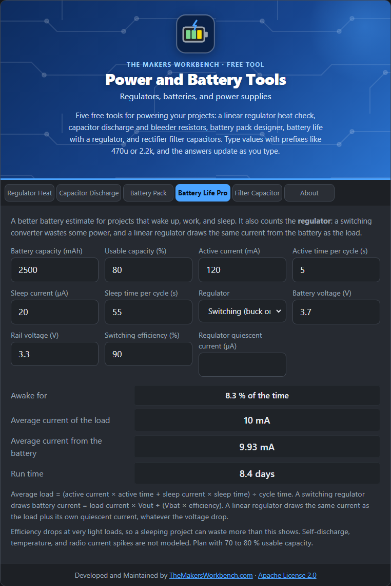

# Battery Life Pro

This is the more detailed battery-life calculator. It handles projects that wake up, work, and sleep, and it accounts for the **voltage regulator**, which changes how much current the battery has to supply.

## The theory

Most battery projects alternate between a high current when working and a tiny current when asleep. The **average load current** is the weighted mix:

**average = (active current × active time + sleep current × sleep time) ÷ (active time + sleep time)**

The battery does not always supply that same current. It depends on the regulator:

- **No regulator**: the battery current equals the load current.
- **Linear regulator**: the battery current equals the load current plus the regulator's own quiescent current. The voltage drop does not reduce it, it just becomes heat.
- **Switching regulator**: it converts power efficiently, so **battery current = load current × Vout ÷ (Vbat × efficiency)**. A buck converter (lowering the voltage) reduces the battery current because the same power is delivered at a higher voltage.

Run time is then **capacity × usable fraction ÷ battery current**.

## Step by step

1. Open the **Battery Life Pro** tab.
2. In **Battery capacity (mAh)**, type the label value, for example `2500`, and in **Usable capacity (%)** leave `80`.
3. In **Active current (mA)** and **Active time per cycle (s)**, type what the project does while awake, for example `120` and `5`.
4. In **Sleep current (µA)** and **Sleep time per cycle (s)**, type the sleeping figures, for example `20` and `55`.
5. In **Regulator**, choose **None**, **Linear**, or **Switching**.
6. For a switching regulator, fill in **Battery voltage (V)**, **Rail voltage (V)**, and **Switching efficiency (%)**, for example `3.7`, `3.3`, and `90`.
7. Optionally enter the **Regulator quiescent current (µA)**.
8. Read **Average current of the load**, **Average current from the battery**, and **Run time**.

## Worked example

A 2500 mAh battery, 120 mA for 5 s then 20 µA for 55 s, with a 90 % efficient 3.7 V to 3.3 V converter. The average load is **10.02 mA**, the battery supplies **9.93 mA**, and the run time is about **201 hours (8.4 days)**.

## Things to watch

- Self-discharge, temperature, and radio current spikes are not modeled.
- Regulator efficiency drops at very light loads, so a sleeping project can waste more than the calculation shows. Choose regulators designed for low quiescent current.
- Plan with about 70 to 80 percent of the rated capacity.

