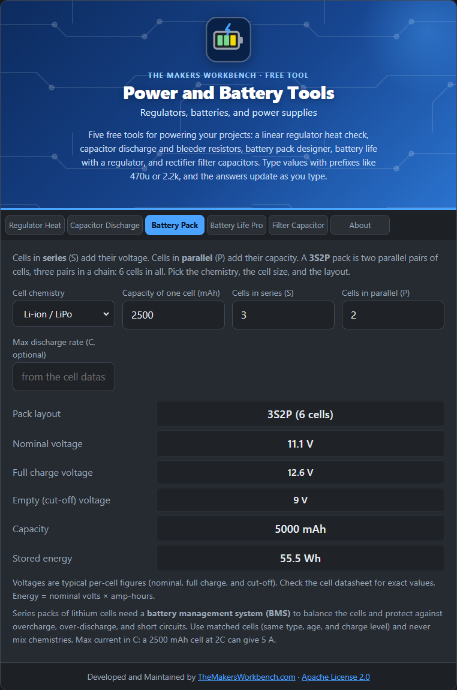

# Battery Pack

A single cell rarely matches a project's needs, so cells are combined into packs. This tool shows what a **series and parallel layout** gives you.

## The theory

- Cells in **series** (end to end) **add their voltage**, and the capacity stays the same.
- Cells in **parallel** (side by side) **add their capacity** (current-delivering ability), and the voltage stays the same.

The layout is written **xSyP**: a **3S2P** pack has 3 groups in series, each with 2 cells in parallel, for 6 cells. Then:

- **Nominal voltage** = cell nominal voltage × S
- **Capacity** = cell capacity × P
- **Energy (Wh)** = nominal voltage × capacity in amp-hours
- **Maximum current** = C-rate × pack capacity (for example, 2C on 5 Ah is 10 A)

Typical per-cell voltages used here (check the cell datasheet): Li-ion/LiPo 3.7 nominal, 4.2 full, 3.0 empty; LiFePO4 3.2, 3.65, 2.5; NiMH 1.2, 1.45, 1.0; alkaline 1.5, 1.6, 0.9; lead-acid per 2 V cell 2.0, 2.35, 1.75.

## Step by step

1. Open the **Battery Pack** tab.
2. In **Cell chemistry**, choose the type of cell.
3. In **Capacity of one cell (mAh)**, type it, for example `2500`.
4. In **Cells in series (S)** and **Cells in parallel (P)**, type your layout, for example `3` and `2`.
5. Optionally, in **Max discharge rate (C, optional)**, type the cell's continuous C-rating from its datasheet.
6. Read the **layout**, the **voltages**, the **capacity**, and the **stored energy**.

## Worked example

Six 2500 mAh Li-ion cells as **3S2P**: a nominal **11.1 V** (12.6 V full, 9.0 V empty), **5000 mAh**, and **55.5 Wh**. At a 2C rating it can supply 10 A.

## Things to watch

- Series lithium packs need a **battery management system (BMS)** to balance the cells and protect against overcharge, over-discharge, and short circuits.
- Use matched cells: the same type, brand, age, and charge level. Never mix chemistries.
- Parallel cells should be connected at the same voltage first, or large currents will flow between them.
- Lithium cells can catch fire if mistreated. Follow the manufacturer's guidance.

