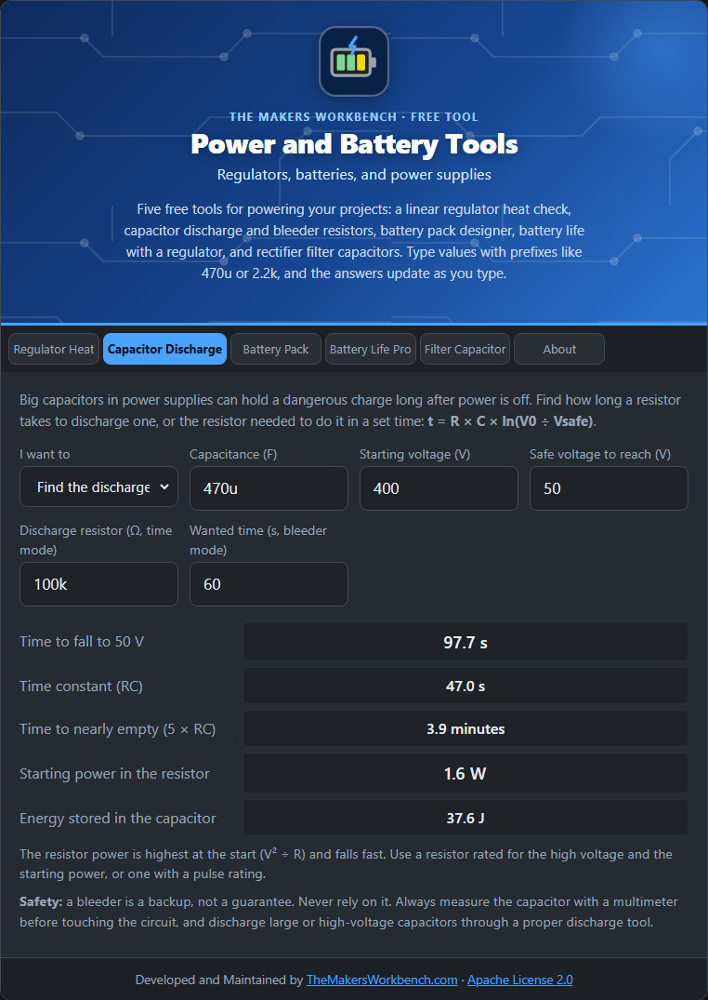

# Capacitor Discharge

Large capacitors in power supplies can hold a dangerous charge for minutes or hours after the power is off. This tool finds how long a resistor takes to discharge one, or which resistor to choose to do it in a set time.

## The theory

A capacitor discharging through a resistor falls along an exponential curve:

**V(t) = V0 × e^(−t ÷ (R × C))**

Solving for the time to fall from V0 to a safe voltage Vsafe gives **t = R × C × ln(V0 ÷ Vsafe)**, where ln is the natural logarithm. The product **R × C** is the **time constant** (τ). After one τ the voltage has dropped to 37 %, after five τ to under 1 %.

Two other numbers matter:

- **Energy stored** = ½ × C × V0², in joules. 37 J is enough to be dangerous.
- **Starting power in the resistor** = V0² ÷ R. It is highest at the start and falls quickly.

## Step by step

1. Open the **Capacitor Discharge** tab.
2. In **I want to**, choose **Find the discharge time** (you have a resistor) or **Find the bleeder resistor** (you want a set time).
3. In **Capacitance (F)**, type the capacitor, for example `470u`.
4. In **Starting voltage (V)**, type the voltage it is charged to, for example `400`.
5. In **Safe voltage to reach (V)**, type the level you consider safe, for example `50`.
6. For time mode, type the resistor in **Discharge resistor (Ω, time mode)**, for example `100k`. For bleeder mode, type your goal in **Wanted time (s, bleeder mode)**, for example `60`.
7. Read the **time** or the **standard resistor value**, plus the **starting power** and **energy stored**.

## Worked examples

- **470 µF at 400 V through 100 kΩ**: it takes **about 98 seconds** (1.6 minutes) to reach 50 V, and 235 seconds to be nearly empty. The resistor starts at 1.6 W. The capacitor stores 37.6 J.
- **Bleeder for a 60 second discharge**: the tool calculates 61.4 kΩ and suggests the next lower standard value, **56 kΩ**, which discharges in about 55 seconds and starts at 2.9 W.

## Things to watch

- Use a resistor with a voltage rating high enough for the starting voltage, and a power or pulse rating for the starting power. A bleeder resistor that stays connected all the time wastes power continuously, so size it for the idle loss too.
- **Safety:** a bleeder is a backup, not a guarantee. Always measure the capacitor with a multimeter before touching the circuit. Discharge large or high-voltage capacitors through a proper discharge tool, not a screwdriver.

