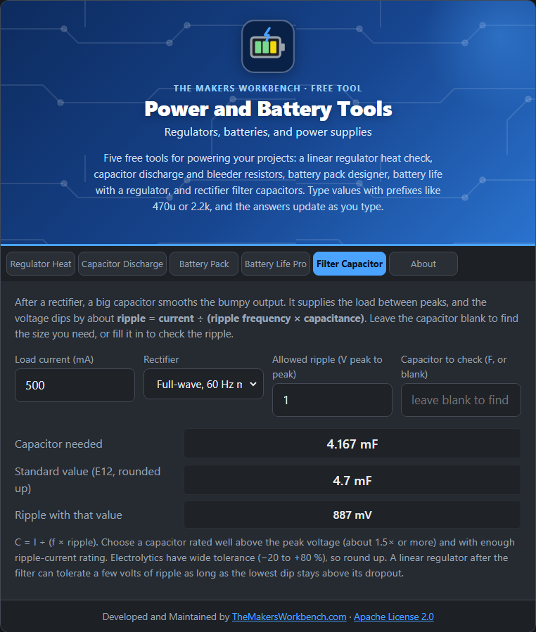

# Filter Capacitor

After a rectifier turns AC into bumpy DC, a large capacitor smooths it. This tool sizes that capacitor or checks the ripple a given one leaves.

## The theory

A rectified supply drops to zero (or near it) between peaks. The filter capacitor holds the voltage up by supplying the load during the gaps. In the gap, the capacitor loses charge steadily, so its voltage falls by the **ripple**:

**ripple (V peak to peak) ≈ load current ÷ (ripple frequency × capacitance)**

Rearranged: **C = I ÷ (f × ripple)**. The ripple frequency depends on the rectifier:

- **Full-wave** (bridge): twice the mains frequency, 100 Hz on 50 Hz mains or 120 Hz on 60 Hz mains.
- **Half-wave** (single diode): the mains frequency, 50 or 60 Hz.

Full-wave rectification needs only half the capacitance for the same ripple, which is why bridges are usual.

## Step by step

1. Open the **Filter Capacitor** tab.
2. In **Load current (mA)**, type the current the supply must deliver, for example `500`.
3. In **Rectifier**, choose your type and mains frequency, for example **Full-wave, 60 Hz mains (120 Hz ripple)**.
4. To find the capacitor, type the ripple you allow in **Allowed ripple (V peak to peak)**, for example `1`, and leave **Capacitor to check** blank.
5. To check an existing capacitor, type it in **Capacitor to check (F)**, for example `4.7m`, and read the **Ripple voltage**.
6. Read **Capacitor needed**, and the **standard value** (rounded up).

## Worked example

A 0.5 A load on 60 Hz full-wave rectification allowing 1 V of ripple needs **4167 µF**. The next standard value is **4700 µF**, which gives about **0.89 V** of ripple.

## Things to watch

- Choose a capacitor with a voltage rating well above the peak voltage (about 1.5 times or more) and with enough ripple-current rating.
- Electrolytic capacitors have wide tolerances (−20 % to +80 %) and **ESR** (internal resistance) that adds ripple, so round up.
- A regulator after the filter can tolerate some ripple, as long as the lowest dip stays above its dropout voltage (see [Regulator Heat](Regulator-Heat)).

