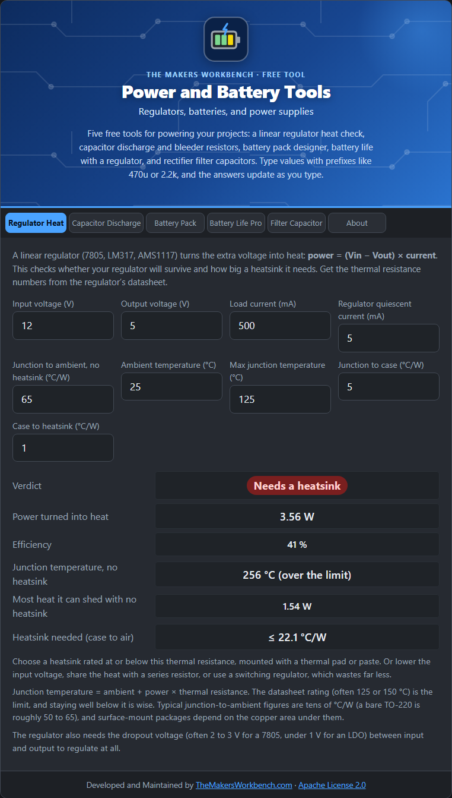

# Regulator Heat

A **linear regulator** (7805, LM317, AMS1117) keeps its output steady by burning off whatever voltage you do not need as heat. That heat is the main reason these parts fail. This tool tells you how hot it will get and what heatsink it needs.

## The theory

The regulator passes the full load current, but only Vout of the voltage goes to the load. The rest, **Vin − Vout**, is dropped across the regulator, so:

**Power as heat = (Vin − Vout) × load current + Vin × quiescent current**

Quiescent current (Iq) is what the regulator itself draws to run (often a few milliamps for a 7805, microamps for an LDO). **Efficiency** is the useful power divided by the input power, which for a linear regulator is roughly **Vout ÷ Vin**.

Heat has to flow from the chip (the **junction**) to the air through several resistances in a chain, each measured in degrees Celsius of rise per watt (°C/W):

- **θJC**: junction to case (the metal tab)
- **θCS**: case to heatsink (the pad or paste between them)
- **θSA**: heatsink to air
- **θJA**: junction to air with no heatsink (what a bare part has)

**Junction temperature = ambient + power × θ.** It must stay under the maximum junction temperature on the datasheet (often 125 or 150 °C), and well under is better for lifespan.

## Step by step

1. Open the **Regulator Heat** tab.
2. In **Input voltage (V)** and **Output voltage (V)**, type your supply and what the regulator makes, for example `12` and `5`.
3. In **Load current (mA)**, type the most the load draws, for example `500`.
4. In **Regulator quiescent current (mA)**, type the datasheet figure, for example `5` for a 7805 (use `0` if unknown).
5. In **Junction to ambient, no heatsink (°C/W)**, type θJA from the datasheet. A bare TO-220 package is roughly 50 to 65.
6. In **Ambient temperature (°C)**, type the temperature inside your enclosure, and in **Max junction temperature (°C)** the datasheet limit.
7. In **Junction to case** and **Case to heatsink**, leave the typical `5` and `1` unless your datasheet says otherwise. These are used if a heatsink is needed.
8. Read the **Verdict**. If it says **Needs a heatsink**, read **Heatsink needed (case to air)**. Pick a heatsink with a thermal resistance at or below that number.

## Worked example

A 7805 turning 12 V into 5 V at 500 mA (5 mA quiescent) makes **3.56 W** and is only **41 %** efficient. With no heatsink the junction would reach **256 °C**, far over the limit. It needs a heatsink of about **22 °C/W or lower**. At 7 V in and 200 mA, it makes only 0.4 W and stays near 53 °C, so no heatsink is needed.

## Things to watch

- If the tool says even a perfect heatsink cannot help, lower the input voltage, reduce the current, or use a **switching (buck) regulator**, which wastes far less.
- The regulator needs a minimum difference between input and output (the **dropout**, often 2 to 3 V for a 7805, under 1 V for an LDO).
- Surface-mount regulators lose heat through the copper under them, so their θJA depends on your board layout.

